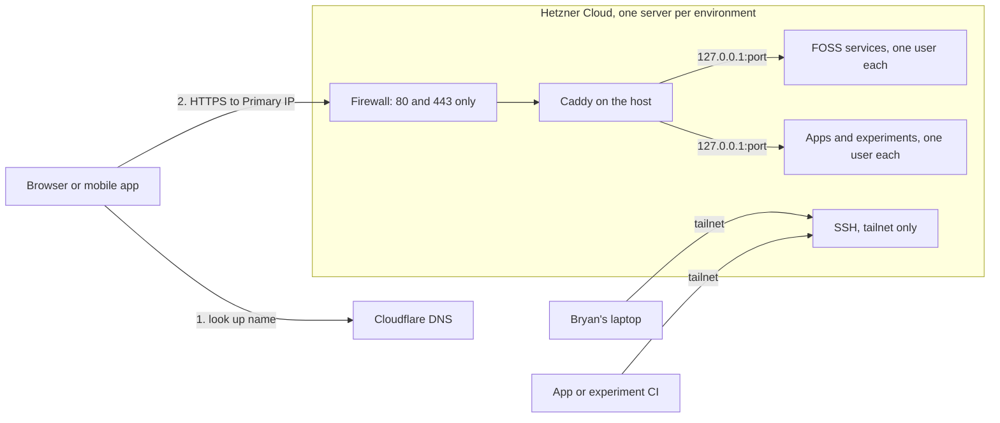

# Spec

See [the readme](../README.md) for an overview of the platform.

This spec describes the long-term vision for the platform: what it will support and how it will be built. The details will evolve, so treat it as a compass heading rather than fixed dogma. It also doesn't prescribe which specific workloads to host or lay out a step-by-step implementation plan.

**Sovereignty is a spectrum.** The long-term vision is a platform built entirely from FOSS and self-hosted pieces. Getting there takes time, so some closed-source hosted services are accepted along the way. Each compromise is named, justified, and paired with a FOSS exit path in [Hosted dependencies and exit paths](#hosted-dependencies-and-exit-paths).

## Contents

- [Nomenclature](#nomenclature)
- [Principles](#principles)
- [Patterns](#patterns)
- [Antipatterns](#antipatterns)
- [Architecture overview](#architecture-overview)
- [Hosted dependencies and exit paths](#hosted-dependencies-and-exit-paths)
- [Environments](#environments)
- [Infrastructure layers](#infrastructure-layers)
- [Pulumi state and deployment](#pulumi-state-and-deployment)
- [Secrets](#secrets)
- [Hosts](#hosts)
- [Networking and access](#networking-and-access)
- [Containers and workloads](#containers-and-workloads)
- [Data, databases, and backups](#data-databases-and-backups)
- [Observability](#observability)
- [First-party workload contract](#first-party-workload-contract)
- [Open questions](#open-questions)

## Nomenclature

| Term                     | Meaning                                                                     | Domain        | Unix user        | Environments |
| ------------------------ | --------------------------------------------------------------------------- | ------------- | ---------------- | ------------ |
| **Workload**             | Anything the platform runs: a FOSS service, an app, or an experiment        | —             | One per workload | —            |
| **FOSS service**         | A third-party, open-source service, defined in this repository              | `drenner.me`  | `foss-<name>`    | Per service  |
| **First-party workload** | An app or experiment Bryan wrote, whose code lives in its own repository    | `drenner.dev` | —                | —            |
| **App**                  | A public first-party workload, for use and demos                            | `drenner.dev` | `app-<name>`     | dev, prod    |
| **Experiment**           | A private first-party workload                                              | `drenner.dev` | `exp-<name>`     | dev only     |
| **Platform**             | The shared infrastructure that runs workloads: servers, Caddy, DNS, backups | —             | —                | dev, prod    |

In code and file names, the three workload kinds are `foss-services`, `apps`, and `experiments`. When an experiment is ready for prod, it graduates into an app.

Other terms used throughout:

- **Workload manifest:** the typed lists in this repository's `manifest/` directory describing every workload: its stable ID, port, and environments, and for first-party workloads, its repository and image. In this spec, "registry" means only a container registry, such as GHCR.
- **Environment tag:** a Git tag named `dev` or `prod` in a first-party repository, pointing at the commit that environment should run.
- **Deploy script:** `/usr/local/bin/deploy` on each server, which makes a first-party workload match its repository's environment tag.

## Principles

- **Vanilla first.** Prefer the boring, widely documented way of doing things. Every unusual choice costs debugging time with fewer tutorials to lean on, and this platform is also a learning project whose skills should transfer to other work.
- **FOSS for everything we run.** All software that runs on our machines (servers, laptop tooling, CI steps) has an OSI-approved license. Closed-source hosted services are allowed only as named, temporary exceptions with a FOSS exit path.
- **Open standards.** Prefer tools that speak open, documented standards (OCI container images, the S3 API, WireGuard, systemd units, ACME, DNS, WebDAV and CalDAV), so any component can be swapped for another implementation.
- **Neutral governance.** Prefer projects governed by foundations or communities, such as Debian or the Linux Foundation, over projects controlled by one company, whose license and direction can change unilaterally. Where a single-vendor tool is chosen, record it and its neutrally governed alternative.
- **Layers change independently.** Infrastructure is split into layers ordered from most stable to most changeable. Each layer depends only on the layers beneath it, so changing a workload never risks a server, and replacing a server never risks data.
- **Disposable compute, durable state.** Servers can be destroyed and rebuilt from code at any time. Anything irreplaceable (data volumes, public IP addresses, backups, Pulumi state) lives in separate, protected resources.
- **Everything as code.** Nothing is configured by hand on a server. If a change isn't in a repository, it doesn't exist. The only exceptions are documented bootstrap steps and break-glass debugging.
- **Git is the source of desired state.** What each environment should run is recorded in Git: FOSS services in this repository, and first-party workloads in their own repositories' environment tags. A rebuilt server converges to Git without any CI run.
- **Least privilege.** Every workload runs as its own unprivileged user in rootless containers, each first-party CI key can run only the deploy script, and SSH isn't reachable from the public internet.
- **No secrets in any repository, encrypted or not.** Repositories declare which secrets exist. The values arrive as environment variables or git-ignored files at deploy time, from wherever the operator keeps them.
- **Dev first, then promote.** Every change lands in dev. Prod runs a commit only after it has run on dev. For first-party workloads, moving a repository's `prod` tag is the promotion step.
- **Build once, deploy many.** Every commit on `main` builds exactly one image, tagged with the commit's full SHA, so a commit identifies its image without any extra record. Promotion reuses that exact image and never rebuilds it.
- **Idempotent.** Running a deployment twice changes nothing the second time. The deploy script does nothing when a workload's commit, configuration, and Quadlets are unchanged. The one deliberate exception is a FOSS service tracking a moving image tag: when the tag points at a newer image, the running service changes without a code change. See [Keeping FOSS images up to date](#keeping-foss-images-up-to-date).
- **Fail loudly and fast.** A broken deploy fails the command or pipeline that caused it, instead of leaving a service silently down.
- **YAGNI and the Rule of Three.** One small server per environment to start. Add machinery only when a real, repeated need appears.
- **Leave the door open to automation.** Nothing assumes it runs on Bryan's laptop, so `sovereign-stack` can later deploy from CI without a redesign.

## Patterns

- **Layered Pulumi projects.** Four projects (`network`, `storage`, `hosts`, `services`), each reading outputs from the layers beneath it. See [Infrastructure layers](#infrastructure-layers).
- **cloud-init for the base node only.** A server is set up once, at first boot, with only what rarely changes. Everything else is delivered afterward over SSH. See [Hosts](#hosts).
- **One Unix user per workload.** Each FOSS service, app, and experiment runs rootless under its own account, so a compromise stays contained. See [Users and isolation](#users-and-isolation).
- **Workload manifest.** Typed lists in `sovereign-stack` record each workload's stable ID, port, environments, and settings, and drive its user, Quadlets, route, directories, and access.
- **Content-hashed sync for FOSS services.** Pulumi renders service definitions and configuration, and uploads and restarts them only when their content changes. See [FOSS service deployment](#foss-service-deployment).
- **Desired-state tags plus a host deploy script.** A first-party repository moves its `dev` or `prod` Git tag, then something calls `deploy` on the server: the repository's CI, Pulumi, or the operator. The script reads the tag and converges. See [The deploy script](#the-deploy-script).
- **Rebuild from the manifest.** When a server is new, Pulumi runs `deploy` for every first-party workload enabled in that environment.
- **Forced-command deploy keys.** Each first-party CI key can run only `deploy`, as its own workload user.
- **Host reverse proxy with localhost-published containers.** Caddy runs directly on the host and forwards each hostname to a container port bound to `127.0.0.1`. See [Routing and port allocation](#routing-and-port-allocation).
- **Sidecar databases.** Each workload that needs a database runs its own database container alongside it.
- **Secrets as environment, from outside the repository.** The operator supplies secrets as git-ignored env files or environment variables. Their source of truth is an independent password manager, plus an offline backup. See [Secrets](#secrets).
- **Commit-SHA images, Git tags for environments.** Images are tagged only `sha-<full commit SHA>` and never re-tagged. Environments are Git tags on commits.
- **Tracking major versions for FOSS images.** FOSS services follow a major-version tag and apply minor updates automatically. Major upgrades are deliberate code changes.
- **Single-use bootstrap credentials.** A new server joins the tailnet with a key that's worthless after first use.
- **Stable addresses.** Public IPs are separate resources assigned to servers, so DNS records survive a server rebuild.
- **Break-glass by configuration.** Emergency access is off by default and switched on with a configuration flag and a deploy, not by hand.

## Antipatterns

- **Secrets in cloud-init `userData`.** Hetzner stores `userData` and serves it from a metadata endpoint that any process on the server can read, including containers. Changing it also forces a server rebuild. **Instead:** `userData` holds only non-secret, rarely changing setup. Secrets arrive over SSH after boot. The single-use tailnet key is the one exception, because it's worthless once used.
- **Leaking secrets into Pulumi state.** Pulumi records every resource input in its state file. A secret value passed to a resource without `pulumi.secret()` is stored in plaintext. **Instead:** wrap every secret with `pulumi.secret()` before it reaches a resource.
- **Workload-level changes through cloud-init.** Editing `userData` to add a user or change a service replaces the whole server. **Instead:** cloud-init covers only the base node. Workload users, files, and services are delivered afterward.
- **Hand-editing the server.** Manual changes drift from the code, are invisible to Pulumi, and vanish at the next rebuild. **Instead:** change the repository and redeploy. When debugging by hand, encode what you learned before moving on.
- **Tying data to a server's lifecycle.** A volume defined alongside its server can be destroyed when the server is replaced. **Instead:** volumes and IPs live in lower layers and use Pulumi's `protect: true`.
- **Deploying floating tags for first-party workloads.** Deploying `:latest` or `:prod` makes it impossible to know exactly what's running, and a restart could silently change versions. **Instead:** the server always runs an exact `sha-<commit>` image, recorded in a Quadlet drop-in. Git environment tags are inputs that resolve to an exact commit at deploy time; they're never image tags.
- **Auto-updating across major versions.** Some services, such as Nextcloud, require upgrading one major version at a time or performing manual steps. **Instead:** track a major-version tag, and bump majors deliberately after reading the release notes.
- **A health check that doesn't gate startup.** In Podman 5.4, a `HealthCmd=` alone doesn't influence auto-update rollback. **Instead:** pair it with `Notify=healthy`, so systemd considers the service started only once it's healthy.
- **Backing up live database files.** Copying a running database's files can capture a half-written, corrupt state. **Instead:** dump the database first (for example with `pg_dump`), back up the dump, and exclude the live database directory from backups.
- **Recursive permission fixes on data.** Using `chown -R` or Podman's `:U` flag after a "permission denied" error walks the entire directory on every container start, which gets slower as data grows. **Instead:** create each directory once, owned by the right user, and use `UserNS=keep-id` when an image needs a specific user ID. See [Storage layout](#storage-layout).
- **Assuming Quadlet files start in order.** Quadlets become ordinary systemd services, which start in parallel. **Instead:** declare order with `Requires=` and `After=`. Quadlet adds these automatically for referenced `.network` and `.volume` files, but not between containers.
- **`sudo -u` to manage a user's services.** `sudo` changes the user but doesn't create a login session, so `systemctl --user` and rootless `podman` can't find the user's systemd manager. **Instead:** SSH in as the workload user. See [Users and isolation](#users-and-isolation).
- **Committing a file named `.env`.** By convention `.env` means git-ignored secrets, and secret scanners flag it. **Instead:** committed, non-secret configuration goes in `deploy/<env>.env`.
- **Public SSH.** An open port 22 attracts constant automated login attempts, and any SSH vulnerability becomes internet-facing. **Instead:** SSH only over the tailnet, with a firewall-based break-glass switch.
- **Storing the only copy of secrets on the infrastructure they recover.** If the source of truth for secrets were a Vaultwarden instance hosted here, losing the server would mean losing every secret. **Instead:** keep them in an independent password manager, plus an offline backup.
- **Routing private data through a third-party proxy.** Cloudflare's proxy decrypts all traffic it forwards. **Instead:** use DNS-only records by default. See [DNS and Cloudflare](#dns-and-cloudflare).

## Architecture overview

> [!eli5] Mapping from AWS
> Most of this platform has an AWS counterpart you've already used. The difference is that here you run the pieces yourself instead of AWS running them for you.
>
> | AWS concept                                    | Sovereign Stack equivalent                        |
> | ---------------------------------------------- | ------------------------------------------------- |
> | CDK or CloudFormation                          | Pulumi                                            |
> | CloudFormation's stored state (managed by AWS) | Pulumi state in an object storage bucket          |
> | EC2 instance                                   | Hetzner Cloud server                              |
> | EBS volume                                     | Hetzner block volume                              |
> | Elastic IP                                     | Hetzner Primary IP                                |
> | Security group                                 | Hetzner firewall                                  |
> | IAM role per service                           | Unix user per workload                            |
> | ECS task definition and service                | Quadlet file generated from the workload manifest |
> | ECR                                            | GHCR (GitHub Container Registry)                  |
> | Application Load Balancer                      | Caddy                                             |
> | ACM certificates                               | Caddy's automatic Let's Encrypt certificates      |
> | Route 53                                       | Cloudflare DNS                                    |
> | Secrets Manager                                | Password manager plus git-ignored env files       |
> | RDS                                            | A database container per workload                 |
> | Bastion host or SSM Session Manager            | Tailscale + SSH                                   |
> | S3                                             | Scaleway Object Storage                           |
> | CloudWatch                                     | VictoriaMetrics + Grafana, plus journald for logs |



**Public requests.** A visitor's browser looks up `immich.drenner.me` in Cloudflare DNS, which answers with the environment's Primary IP. The browser connects over HTTPS. Hetzner's firewall admits only web traffic. Caddy terminates TLS, reads the requested hostname, and forwards the request to the matching container on `127.0.0.1`.

**Administration and deployment.** Bryan's laptop and CI pipelines join a private Tailscale network (a tailnet) and reach SSH through it. SSH never listens on the public internet.

## Hosted dependencies and exit paths

These closed-source hosted services are accepted exceptions. Each has a FOSS exit path, and the platform avoids features that would block the move.

| Dependency                    | Used for                                              | FOSS exit path                                          |
| ----------------------------- | ----------------------------------------------------- | ------------------------------------------------------- |
| GitHub                        | Code hosting for all repositories, public and private | Forgejo (self-hosted) or Codeberg                       |
| GitHub Actions                | CI and deployment triggers for apps and experiments   | Forgejo Actions or Woodpecker CI                        |
| GHCR                          | App and experiment images                             | Forgejo's built-in registry, Zot, or CNCF Distribution  |
| Tailscale coordination server | Management network                                    | Headscale (the Tailscale clients are already FOSS)      |
| Cloudflare DNS                | DNS for `drenner.me` and `drenner.dev`                | deSEC, or self-hosted authoritative DNS                 |
| Scaleway Generative APIs      | LLM inference for a self-hosted chat interface        | Self-hosted models (for example Ollama) on GPU hardware |
| Scaleway Object Storage       | Pulumi state and backups                              | Any S3-compatible provider, or self-hosted Garage       |
| Hetzner Cloud                 | Servers, volumes, IPs, firewall                       | Any VPS provider that supports cloud-init               |

Private first-party repositories and images are allowed. The server receives GitHub credentials only for the duration of a deploy and never stores them. See [Private repositories](#private-repositories).

Excluded because they're closed-source or source-available rather than OSI-licensed: Pulumi Cloud, Pulumi ESC, HashiCorp Terraform, Vault, and Nomad, and Docker Desktop.

### Governance notes

Some chosen FOSS tools are controlled by a single company. They're used for pragmatic reasons, with a neutrally governed alternative on record:

| Tool      | Steward       | Neutrally governed alternative                                |
| --------- | ------------- | ------------------------------------------------------------- |
| Pulumi    | Pulumi Corp   | OpenTofu (Linux Foundation)                                   |
| Tailscale | Tailscale Inc | Headscale with the FOSS Tailscale clients, or plain WireGuard |

## Environments

There are two environments, each with its own server and its own Pulumi stacks. Each server is sized to what its environment actually runs.

| Environment | FOSS services           | Apps                     | Experiments              | Data                      |
| ----------- | ----------------------- | ------------------------ | ------------------------ | ------------------------- |
| `dev`       | `<name>.dev.drenner.me` | `<name>.dev.drenner.dev` | `<name>.dev.drenner.dev` | Disposable, not backed up |
| `prod`      | `<name>.drenner.me`     | `<name>.drenner.dev`     | —                        | Backed up nightly         |

- **Promotion for `sovereign-stack`.** Apply a change to the dev stacks, check it, then apply the same commit to the prod stacks.
- **Promotion for apps.** Merging to `main` builds the image, moves the `dev` tag, and deploys to dev. Moving the `prod` tag to a commit that has run on dev deploys it to prod. There's no approval gate; moving the tag is the decision. See [First-party workload contract](#first-party-workload-contract).
- **Rollback for apps and experiments.** Move the environment tag back to an earlier commit and push it. The tag push triggers a redeploy.
- **Experiments** live only on dev, with only a `dev` tag. An experiment ready for prod graduates into an app.
- **Per-service FOSS environments.** Each FOSS service's manifest entry lists its environments, as apps do. Dev runs only the FOSS services being tested.
- **Staggered FOSS updates.** Dev applies FOSS image updates daily and prod weekly, so dev acts as an early warning for bad releases.
- **Capacity.** Hetzner's smallest CX server is unlikely to run Immich (with machine learning), Nextcloud, a chat interface, and a Postgres per workload at once. Size each environment's server to what it runs; prod will likely need a larger type than dev.

### Alternatives

| Option                                          | Pros                                               | Cons                                              |
| ----------------------------------------------- | -------------------------------------------------- | ------------------------------------------------- |
| One server, no dev                              | Cheapest and simplest                              | Every mistake lands on the services you depend on |
| **Dev and prod servers (chosen)**               | Safe rehearsal; dev doubles as the experiment host | Twice the servers to pay for and patch            |
| Dev, prod, and a separate experiments server    | Experiments can't starve dev of resources          | A third server with little benefit at this scale  |
| Temporary preview environments per pull request | Mirrors large teams' practice                      | Far more machinery than one person needs (YAGNI)  |

### Server architecture

Both servers use x86 (`amd64`) CPUs from Hetzner's shared "CX" line.

| Option                    | Pros                                                                              | Cons                                                                            |
| ------------------------- | --------------------------------------------------------------------------------- | ------------------------------------------------------------------------------- |
| **x86, CX line (chosen)** | Currently Hetzner's cheapest entry server; every published FOSS image supports it | Apple Silicon Macs build `amd64` images only through emulation, which is slower |
| ARM, CAX line             | Matches Apple Silicon, so local builds are native                                 | Currently slightly more expensive; a few FOSS images lack ARM builds            |

Deployable images are built in CI, whose standard runners are x86, so emulation affects only local builds. See [Building images](#building-images).

## Infrastructure layers

> [!eli5] Pulumi projects, stacks, and references
> Pulumi turns TypeScript code into real cloud resources.
>
> - A **project** is one Pulumi program: a folder with a `Pulumi.yaml` file and some code.
> - A **stack** is one deployed instance of a project, such as its `dev` or `prod` copy. Each stack has its own settings and its own record of what it created (its **state**).
> - A **stack reference** lets one project read another project's published outputs, such as a server's IP address.
>
> Splitting infrastructure into several projects means each one is small, previews quickly, and can't accidentally touch resources owned by another. It's like splitting one huge CloudFormation template into several nested stacks.

The infrastructure is four Pulumi projects. Each has a `dev` and a `prod` stack, and each reads outputs only from the layers beneath it.

| Layer      | Contains                                                                                      | Changes      | Reads from                    |
| ---------- | --------------------------------------------------------------------------------------------- | ------------ | ----------------------------- |
| `network`  | Primary IPs, firewall rules, Cloudflare DNS records                                           | Rarely       | Nothing                       |
| `storage`  | Block volumes and backup buckets                                                              | Rarely       | Nothing                       |
| `hosts`    | Servers, cloud-init, volume attachments, single-use tailnet keys                              | Occasionally | `network`, `storage`          |
| `services` | Workload users and directories, Caddy configuration, all Quadlets, runtime secrets, schedules | Often        | `network`, `storage`, `hosts` |

First-party workloads' code and environment tags live in their own repositories. Their shape is defined in the manifest and installed by `services`, and their versions come from their repositories. See [First-party workload contract](#first-party-workload-contract).

The Tailscale access policy sits outside the layers, in its own repository. See [Tailnet policy repository](#tailnet-policy-repository).

### Network

- **Primary IPs.** One IPv4 and one IPv6 address per environment, protected from deletion. Servers are assigned these addresses, so DNS never changes when a server is rebuilt.
- **Firewall.** Rules admitting public web traffic, applied to servers by label (for example `env=dev`), so the `hosts` layer only has to label its servers. A break-glass flag adds a temporary SSH rule. See [Break-glass access](#break-glass-access).
- **DNS records.** Four wildcard records pointing at each environment's Primary IPs: `*.drenner.me` and `*.drenner.dev` for prod, `*.dev.drenner.me` and `*.dev.drenner.dev` for dev. A new workload needs no DNS change. Both domains already have email records; Pulumi doesn't manage them, and wildcards never override names that have their own records.

### Storage

- **Block volumes.** One per environment, protected from deletion. See [Storage layout](#storage-layout).
- **Backup bucket.** A Scaleway Object Storage bucket for prod backups.

The Pulumi state bucket is deliberately not managed here. Pulumi needs it to exist before it can run at all, so it's created once by hand. See [Pulumi state and deployment](#pulumi-state-and-deployment).

### Hosts

- **Servers.** One per environment, built from a stock Debian image and configured at first boot by cloud-init.
- **Volume attachments.** Connect each environment's volume to its server, then mount it.
- **Single-use tailnet keys.** Created alongside each server with Pulumi's Tailscale provider, so a replacement server gets a fresh key.

### Services

- **Workload users and directories.** One Unix user per workload, with its sub-UID range, lingering, authorized SSH keys, and data directory. See [Users and isolation](#users-and-isolation).
- **Caddy configuration.** Site blocks for every workload in the manifest.
- **Quadlets for every workload,** generated from the manifest. FOSS services also get their configuration files. First-party workloads get only their Quadlets, because their image and configuration come from their own repositories.
- **Runtime secrets** for every workload. See [Secrets](#secrets).
- **The deploy script,** installed at `/usr/local/bin/deploy`. See [The deploy script](#the-deploy-script).
- **First-party deploys on a new server:** a `deploy` run for every first-party workload enabled in the environment.
- **Schedules.** Backup, database dump, and auto-update timers.

### Tailnet policy repository

The Tailscale access policy isn't part of any layer. It lives in a small, separate repository, applied by Tailscale's GitOps GitHub Action (`tailscale/gitops-acl-action`), and is treated as upstream of `sovereign-stack`. Policy changes get no dev rehearsal, so the policy file's `tests` section checks access rules before they apply. The `hosts` layer still uses Pulumi's Tailscale provider, but only to create single-use server join keys.

> [!eli5] Why the tailnet policy can't live in two stacks
> Tailscale gives each tailnet exactly one policy document, the single file saying which devices and tags may reach what. Pulumi's Tailscale provider manages that whole document as one resource.
>
> If both the `dev` and `prod` stacks of one project declared it, each `pulumi up` would replace the entire document with that stack's version. Whichever stack ran last would win. If dev's version only mentioned dev servers, applying it would silently delete prod's access rules. So anything account-wide needs exactly one owner.

### Why four layers

| Option                                            | Pros                                                      | Cons                                                                       |
| ------------------------------------------------- | --------------------------------------------------------- | -------------------------------------------------------------------------- |
| One project, with `protect` on stateful resources | Simplest code; no cross-project references                | Every `pulumi up` evaluates everything; one mistake can reach any resource |
| Two projects: base and services                   | Separates fast-changing services from everything else     | Data and servers still share a lifecycle                                   |
| **Four projects (chosen)**                        | Each lifecycle is isolated; small, fast, focused previews | Eight stacks; the first bring-up must run in layer order                   |

### Repository layout

```text
sovereign-stack/
├── layers/
│   ├── network/          # Pulumi project: IPs, firewall, DNS
│   ├── storage/          # Pulumi project: volumes, backup bucket
│   ├── hosts/            # Pulumi project: servers, cloud-init, tailnet join keys
│   └── services/         # Pulumi project: users, Caddy, Quadlets, secrets, deploys
├── manifest/             # Typed workload lists: foss-services, apps, experiments
├── foss-services/        # FOSS service definitions (Quadlets, config templates)
│   └── <name>/
├── host/
│   └── deploy            # The deploy script installed on each server
├── .github/
│   └── workflows/
│       └── deploy.yml    # Reusable workflow first-party repositories call
├── lib/                  # Shared TypeScript: types, naming, host conventions
├── secrets.schema.ts     # Which secrets exist, per environment and workload, validated with zod
├── secrets.example/      # Fake values showing each file's expected shape
├── secrets/              # Git-ignored; filled by the operator
├── docs/
│   └── spec.md
├── package.json          # One package shared by all four projects
└── pulumi                # Wrapper: loads deploy secrets, then runs Pulumi
```

## Pulumi state and deployment

> [!eli5] What Pulumi state is
> Pulumi keeps a record of every resource it created and what it looked like: its **state**. On the next run, Pulumi compares your code to that record to decide what to create, change, or delete. If the state is lost, Pulumi forgets it owns your servers. It would try to create duplicates, and you'd have to clean up or re-import resources by hand. So state must be stored somewhere safe, backed up, and reachable from any machine you deploy from. AWS keeps CloudFormation's equivalent for you; with Pulumi, you choose where it lives.

### Where state lives

| Option                                    | Pros                                               | Cons                                                        |
| ----------------------------------------- | -------------------------------------------------- | ----------------------------------------------------------- |
| Pulumi Cloud                              | Pulumi's default, with a web UI                    | Closed-source service; excluded                             |
| Local files on the laptop                 | Zero setup                                         | Lost with the laptop; not usable from another machine or CI |
| **S3-compatible object storage (chosen)** | Reachable from any machine or CI; versioned; cheap | One manual bootstrap step to create the bucket              |
| Committed to Git                          | Versioned for free                                 | Merge conflicts; no locking; easy to leak secrets           |

**Decision.** State lives in a Scaleway Object Storage bucket, separate from Hetzner, with object versioning enabled so every previous state is recoverable. Keeping state off Hetzner means that even losing the Hetzner account leaves a complete map of what existed. The bucket is created once by hand, because Pulumi can't manage the bucket that holds its own state.

- **Login:** `pulumi login 's3://<bucket-name>'`, with Scaleway's endpoint and region supplied through the wrapper's environment.
- **Locking:** Pulumi locks a stack in a self-managed backend during an update, but the lock isn't transactional. If an update dies uncleanly, the stale lock must be removed by hand before the next run.

> [!collab] Verify the Scaleway endpoint
> Confirm which environment variables Pulumi's S3 backend reads for a non-AWS endpoint and region.

### The root of trust

Pulumi encrypts secrets in its state using a **passphrase**. That passphrase, the state bucket credentials, the provider API tokens (Hetzner, Cloudflare, Scaleway, Tailscale), the SSH automation private key, and a read-only GitHub token (see [Private repositories](#private-repositories)) are the **deploy secrets**. The `./pulumi` wrapper loads `secrets/<env>/deploy.env` into the environment if the file exists, then runs Pulumi. Variables already set in the environment take precedence, so a secrets manager's command-line tool can inject values instead of a file.

**Working from a new machine:**

1. Install the tools (Node and Pulumi).
2. Clone `sovereign-stack`, then fill `secrets/` from the password manager.
3. Log in to the state backend and select a stack.

### Deploying from CI later

Deploying `sovereign-stack` from CI would need only two things: the secrets as environment variables or files from the CI platform's secret store, and tailnet access for the `services` layer. Nothing else assumes a laptop. For one operator, running Pulumi locally is standard, and CI is unnecessary for now.

## Secrets

### What the repository defines

`sovereign-stack` defines **which** secrets exist, never where their values come from:

- `secrets.schema.ts` declares every deploy secret and runtime secret, per environment and per workload, and validates what's supplied. Validation errors name the missing or malformed key, never the value.
- `secrets.example/` shows each file's expected shape with fake values.

### Where secret values come from

The operator fills a git-ignored `secrets/` directory, one file per purpose:

```text
secrets/                        # Git-ignored; filled by the operator
├── dev/
│   ├── deploy.env              # Credentials Pulumi needs to deploy dev
│   ├── platform.env            # Platform runtime values, such as the restic password and basic-auth hash
│   ├── foss-immich.env         # One file per FOSS service, named after its Unix user
│   └── app-demo-app.env        # One file per first-party workload, named after its Unix user
└── prod/
    └── …
```

Naming each runtime file after its workload's Unix user makes delivery a one-to-one copy. How the files get filled is the operator's business: exported from a password manager, generated by its command-line tool, or typed by hand.

**Source of truth.** An independent password manager, plus an offline backup. It must not be a service hosted on this platform, such as its own Vaultwarden.

**Scaleway API keys** are created by hand, once, and scoped narrowly: one for Pulumi (the state bucket and the backup bucket's creation), one for restic to write backups, and one for Generative APIs. The Generative APIs key is a runtime secret of the self-hosted chat interface, such as Open WebUI. Pulumi doesn't manage any of them.

### How secrets reach workloads

- **Deploy secrets.** The `./pulumi` wrapper loads them as environment variables.
- **Runtime secrets, for FOSS services and first-party workloads alike.** The `services` layer reads each workload's file, wraps every value in `pulumi.secret()`, and writes it over SSH, as that workload's user, to `~/.config/secrets/runtime.env` with mode `0600`. Quadlets read it through `EnvironmentFile=`.
- **The deploy script never touches secrets.** They're already on the server, and Pulumi redelivers them to a rebuilt server.
- **Ordering.** Adding a secret to a first-party workload requires a `sovereign-stack` deploy before the workload's deploy that uses it.

Plaintext never touches Git, `userData`, or unencrypted Pulumi state.

### Risks

- **Plaintext at rest on the operator's machine.** Require full-disk encryption and mode `0600` on everything in `secrets/`.
- **Human error.** Accidentally committing a secrets file is the most likely leak. Keep `secrets/` in `.gitignore`, and run gitleaks (FOSS) as a pre-commit hook and CI check.
- **Losing the state passphrase.** Pulumi state holds secret values encrypted with the passphrase, so losing it makes state unreadable. The passphrase belongs in the password manager with everything else.
- **A leaked secret stays leaked.** Rotation is manual: change the value at its source, update the password manager, and redeploy.

### Alternatives

| Option                                                     | Pros                                                                                  | Cons                                                                                                |
| ---------------------------------------------------------- | ------------------------------------------------------------------------------------- | --------------------------------------------------------------------------------------------------- |
| **Git-ignored env files from a password manager (chosen)** | No secrets in any repository; works with any secrets source; the most common approach | Plaintext on the operator's disk; a manual step on each new machine                                 |
| SOPS + Age files in the repository                         | Versioned and reviewed with code                                                      | Ciphertext and secret names in Git forever; secrets don't belong in repositories, even encrypted    |
| SOPS + Age files kept outside the repository               | Encrypted at rest                                                                     | Extra tools and key management with no benefit once files never enter Git                           |
| Per-repository GitHub Actions secrets                      | Built into CI                                                                         | Unusable for `pulumi up` from a laptop; environments unavailable for private repos on the Free plan |
| Infisical or OpenBao (self-hosted)                         | FOSS, with audit logs and rotation                                                    | Another service to run, with its own bootstrap secrets                                              |
| Bitwarden Secrets Manager, Pulumi ESC                      | —                                                                                     | Closed-source; not used by the repository                                                           |

## Hosts

### Operating system

> [!eli5] Linux distributions
> A distribution ("distro") is Linux plus a curated set of packages, an update policy, and a support lifetime. For a server, the questions are: how long does it get security updates, how current is the software you need (here, Podman), and how much special knowledge does it demand?

Stock images available on Hetzner Cloud include:

| Distro                 | Podman version                                        | Support length                  | Notes                                                                           |
| ---------------------- | ----------------------------------------------------- | ------------------------------- | ------------------------------------------------------------------------------- |
| **Debian 13 (chosen)** | 5.4.2, in the main archive with security team support | About five years, including LTS | Community-governed; conservative; uses AppArmor                                 |
| Ubuntu 26.04 LTS       | 5.7, but in the "universe" archive                    | Five years standard             | Universe packages get community security support unless you pay for Ubuntu Pro  |
| Fedora 44              | Newest available                                      | About 13 months                 | Podman's upstream home, but needs a major upgrade or rebuild roughly every year |
| AlmaLinux or Rocky     | Current (RHEL-aligned)                                | About ten years                 | Podman is first-class, but SELinux adds a layer of permission labeling to learn |

Fedora CoreOS isn't offered as a stock Hetzner image and would need a custom uploaded snapshot.

**Decision: Debian 13.** Its Podman package gets security support from Debian's security team, it uses AppArmor (so there's no SELinux labeling to manage), and it's governed by a community rather than a company.

**What Podman 5.4 lacks.** Newer Podman releases add conveniences this platform can live without:

- Quadlet `Memory=`, `Retry=`, and `ReloadCmd=`. Memory limits can be set through `PodmanArgs=--memory=…` instead.
- The `podman quadlet install | list | rm` commands. This platform syncs Quadlet files itself.
- `.volume` `UID=` and `GID=` options.
- Rootless port forwarding that preserves the client's source IP. This doesn't matter here, because Caddy on the host passes the client IP to workloads in headers.

`Notify=healthy`, which this platform relies on, is supported in 5.4.

### cloud-init

> [!eli5] What cloud-init does
> When Hetzner creates a server, you can hand it a configuration file called `userData`. A program on the server, **cloud-init**, reads that file during the very first boot and follows it: install these packages, create these users, write these files. It only runs once. Changing `userData` later means Pulumi must destroy and rebuild the server to apply it. That's why cloud-init holds only things that almost never change.

cloud-init is responsible for:

- **Packages:** Podman and its rootless helpers (such as `uidmap`, `dbus-user-session`, and `passt`), Caddy from Caddy's official apt repository, Tailscale from Tailscale's apt repository, restic, rsync, and unattended-upgrades.
- **The admin account:** `bryan`, with a locked password, SSH keys (a personal key plus an automation key for Pulumi), and passwordless `sudo`.
- **SSH hardening:** key-only login and no root login.
- **The data volume's fstab entry and mount point.** See [Storage layout](#storage-layout).
- **Automatic security updates:** unattended-upgrades configuration.
- **Joining the tailnet:** `tailscale up` with a single-use, pre-tagged key.

cloud-init is **not** responsible for workload users, services, Caddy site configuration, or any long-lived secret.

**Why Caddy's own repository.** Debian 13 ships Caddy 2.6.2, released in 2022, with open security issues. Debian's backports archive carries a current 2.11 release, but backports get only best-effort security support. Caddy's official repository tracks upstream releases directly.

**Known cloud-init behaviors this design accounts for:**

- **The `mounts:` module skips devices that aren't attached yet.** cloud-init's documentation says mounts that don't match an attached block device are skipped. The volume is attached after the server is created, so it's missing during first boot. The fstab entry is therefore written with `write_files`, and the `hosts` layer mounts the volume once the attachment completes.
- **`write_files` runs before users are created.** A file owned by a newly created user needs `defer: true`. Nothing in this design needs that, because every file cloud-init writes is owned by root.
- **fstab uses `nofail`.** With `nofail`, boot continues even if the volume is missing. `x-systemd.device-timeout` bounds how long the mount itself waits for the device.

### Users and isolation

> [!eli5] Users, root, and rootless containers
> Linux protects things by _user_. The all-powerful user is **root**. Normally, a container engine runs as root, so a container that escapes its isolation becomes root on the host. **Rootless** Podman runs containers as an ordinary user instead, so an escape only gains that user's limited powers.
>
> Inside a rootless container, a process can still _believe_ it's root. Podman maps the container's user IDs onto a private range of IDs the host user owns (its **sub-UIDs**). Container root becomes the ordinary host user, and other container users become harmless numbers from that range.
>
> Giving each workload its own user means each is walled off from the others, like giving each ECS service its own IAM role.

**One Unix user per workload.** Every FOSS service, app, and experiment runs rootless under its own account (`foss-<name>`, `app-<name>`, `exp-<name>`). A compromised experiment can't read Immich photos, and a leaked CI credential for one app reaches only that app.

| Account       | Used by                                                         | Can do                                                                              |
| ------------- | --------------------------------------------------------------- | ----------------------------------------------------------------------------------- |
| `bryan`       | Bryan, and Pulumi with its automation key                       | Full `sudo`; creates workload users and installs system files such as the Caddyfile |
| `foss-<name>` | Pulumi, over SSH                                                | Runs one FOSS service                                                               |
| `app-<name>`  | Pulumi over SSH, and that app's CI through `deploy` only        | Runs and redeploys one app                                                          |
| `exp-<name>`  | Pulumi over SSH, and that experiment's CI through `deploy` only | Runs and redeploys one experiment                                                   |

**How workload users are created.** Users can't come from cloud-init, because adding a workload would then rebuild the server. The `services` layer creates them over SSH, as `bryan`, after boot:

- Each workload in the manifest has a **stable numeric ID** that's never reused. Its Unix UID and its sub-UID range are derived from that ID, so ranges never overlap and never shift when the manifest changes. A rebuilt server recreates each user with the same UID, so the files on the volume still belong to the right user.
- Sub-UID ranges are assigned explicitly (`usermod --add-subuids`), rather than trusting `useradd` to choose them.
- Lingering is enabled with `loginctl enable-linger`, which takes effect immediately, so the user's services run at boot without a login.
- Each user's `authorized_keys` holds Pulumi's automation key and, for first-party workloads, the workload's CI key restricted to the deploy script. See [The deploy script](#the-deploy-script).

**How Pulumi acts as a workload user.** Pulumi SSHes in _as_ each workload user to install Quadlets, write secrets, and restart services. It never uses `sudo -u`, which can't manage another user's services.

> [!eli5] Why `sudo -u` can't manage a user's services
> systemd comes in two kinds. The **system manager** (PID 1) runs system services like Caddy and SSH. Each user can also have a **user manager**, a separate systemd process running as that user. Rootless Quadlets become services under the user manager. Lingering keeps a user's manager running even when nobody is logged in.
>
> `systemctl --user` finds the right user manager through a socket in `/run/user/<uid>/`, which it locates using the environment variable `XDG_RUNTIME_DIR`. A real login sets that variable: when you SSH in, the login machinery (PAM's `pam_systemd`) creates the directory and sets the variable for your session.
>
> `sudo -u foss-immich` changes _which user you are_, but it doesn't go through login setup. The variable is missing or still points at your own directory, so `systemctl --user` fails with an error like "Failed to connect to bus," or talks to the wrong manager. Rootless `podman` commands have the same problem.
>
> The fixes, from most to least vanilla:
>
> 1. SSH in as the user. It's a genuine login, so everything is set correctly. This platform does this.
> 2. As root, `systemctl --user -M foss-immich@ restart immich` connects to that user's manager directly. `machinectl shell foss-immich@` opens an interactive shell the same way, which is handy for break-glass debugging.
> 3. Set the variable by hand: `sudo -u foss-immich XDG_RUNTIME_DIR=/run/user/1101 systemctl --user …`. It works, but it's brittle.

**Deploy users versus runtime users.** For apps and experiments, the runtime user doubles as the deploy target: CI connects over SSH as `app-<name>`, with a key that can only run the deploy script. A separate deploy user would still need to act as the runtime user to install files and restart services, so it would add accounts without adding much isolation.

| Option                                                              | Pros                                                  | Cons                                                                                    |
| ------------------------------------------------------------------- | ----------------------------------------------------- | --------------------------------------------------------------------------------------- |
| One shared service user                                             | Simplest                                              | A container escape from any workload reaches all data                                   |
| Separate users for FOSS services and for first-party workloads      | Protects FOSS data from experiments                   | Apps and experiments can reach each other                                               |
| **One user per workload, which is also its deploy target (chosen)** | Strongest isolation; each CI key reaches one workload | More accounts; users must be created after boot                                         |
| One user per workload plus a separate deploy user for each          | Runtime users never accept logins                     | Doubles the accounts; the deploy user needs rights over the runtime user anyway         |
| One shared deploy user with `sudo` into every workload              | One CI identity                                       | One leaked key reaches everything                                                       |
| Rootful Podman with `UserNS=auto`                                   | Per-container isolation without per-workload users    | Podman runs as root; deploys need a privileged entry point; not chosen, noted for later |

### Storage layout

> [!eli5] Why a separate volume
> A server's own disk disappears when the server is rebuilt. A **block volume** is a separate virtual disk, like an EBS volume, that you attach to a server. It survives when the server is replaced, and you can resize it independently. All data that matters lives there.

```text
/mnt/data/               # Volume mount point
├── caddy/               # Owned by caddy: certificates
├── foss-<name>/         # Owned by foss-<name>
├── app-<name>/          # Owned by app-<name>
│   ├── data/            # Mounted at /data in the workload's container
│   ├── postgres/        # A sidecar database's live files; excluded from backups
│   └── dumps/           # Database dumps; backed up
└── exp-<name>/          # Owned by exp-<name>, laid out like an app
```

- **Fail closed.** The empty mount-point directory is owned by root and read-only. If the volume ever fails to mount, workloads get "permission denied" instead of silently writing to the server's disposable disk.
- **User managers wait for the volume.** The mount uses `nofail`, so lingering user managers could start before `/mnt/data` is mounted. Their containers would then fail against the fail-closed mount point, and `Restart=always` can exhaust systemd's start limit and leave them stopped. A drop-in for `user@.service` with `RequiresMountsFor=/mnt/data` makes every user manager wait for the volume.
- **One owner per directory.** Each directory is owned by exactly one user and created once, with no recursive ownership changes anywhere.
- **Fixed-UID images.** Rootless container root already maps to the owning host user, so most images just work. For an image that insists on a specific non-root user ID, use Quadlet's `UserNS=keep-id:uid=N,gid=N` to map the host user to that ID, rather than changing file ownership.
- **First-party layout.** Generated first-party Quadlets use the `data/`, `postgres/`, and `dumps/` subdirectories shown above. FOSS services lay out their own directories, following the same rule: live database files and dumps in separate subdirectories.
- **Home directories stay on the server's disposable disk.** Nothing in a home directory is irreplaceable. A rebuild restores FOSS services and first-party workloads from code, the manifest, and their repositories' environment tags, not from disk.
- **No SELinux flags.** Debian uses AppArmor, so SELinux relabeling options (`:z` and `:Z`) don't apply.

### Operating system updates

> [!eli5] Patches versus upgrades
> **Patches** are fixes within one release, such as Debian 13.1 to 13.2. **Upgrades** move to a new release, such as Debian 13 to 14. unattended-upgrades only installs patches. The repository says `debian-13`, and that stays accurate. Moving to Debian 14 is a deliberate change: update the image name and rebuild the server.

- **Patches install automatically.** unattended-upgrades applies security patches daily. A rebuilt server starts from Hetzner's current Debian 13 image and receives the same patches, so rebuilt and long-running servers converge.
- **Reboots are automatic.** Kernel patches take effect only after a reboot, so unattended-upgrades reboots the server in a quiet nightly window, and only when a patch requires it. Workloads come back on their own, because every workload user has lingering enabled.
- **Prod reboots after dev.** Dev's reboot window comes first, so a patch that breaks booting shows up on dev before prod.

| Option                                     | Pros                                                       | Cons                                                  |
| ------------------------------------------ | ---------------------------------------------------------- | ----------------------------------------------------- |
| **Automatic reboots in a window (chosen)** | Patches always take effect; no chore to forget             | A minute or two of downtime at night, without warning |
| Manual reboots, with an alert              | Downtime only when you choose; builds hands-on familiarity | Depends on following up on the alert                  |
| Live kernel patching                       | Fewer reboots                                              | Mostly tied to paid vendor services; more complexity  |

## Networking and access

### Public ingress and firewall

> [!eli5] Ports and firewalls
> A server listens for connections on numbered **ports**: 80 for plain web traffic, 443 for encrypted web traffic, 22 for SSH. A **firewall** decides which ports the internet may reach. Hetzner's cloud firewall filters traffic before it ever reaches the server, much like an AWS security group.

The firewall admits only:

- TCP 80, so Let's Encrypt can verify certificates and Caddy can redirect to HTTPS.
- TCP 443, and optionally UDP 443 for HTTP/3.
- ICMP, so ping and network diagnostics work.
- Any extra ports a workload declares in the manifest. For example, Syncthing's sync protocol uses port 22000, which isn't web traffic.

Port 22 is closed to the internet. Tailscale needs no inbound ports, because it connects outward.

**UDP 41641 stays closed by default.** Opening it lets other tailnet devices connect to the server directly, instead of sometimes relaying through Tailscale's servers. The risk is small: WireGuard doesn't respond to packets that aren't properly authenticated, so the port reveals almost nothing to scanners. But the benefit is also small, because a server with a public IP usually gets direct connections anyway. Open it only if `tailscale status` shows slow, relayed connections.

### DNS and Cloudflare

> [!eli5] DNS, and what "proxied" means
> **DNS** is the internet's phone book: it turns `immich.drenner.me` into an IP address. Cloudflare hosts the phone books for `drenner.me` and `drenner.dev`.
>
> Cloudflare can also **proxy** a record (the orange cloud in its dashboard). Visitors then connect to Cloudflare instead of your server, and Cloudflare forwards the traffic. That hides your server's address and absorbs attacks. But to forward HTTPS, Cloudflare must decrypt it, so Cloudflare can read everything that passes through.

**Decision.** Cloudflare hosts DNS for both domains. Pulumi manages the wildcard records, which are **DNS-only**, not proxied.

| Cloudflare proxy           | Detail                                                                                                                                  |
| -------------------------- | --------------------------------------------------------------------------------------------------------------------------------------- |
| For: DDoS protection       | Absorbs large attacks. Hetzner's network also includes baseline DDoS mitigation, and a personal platform is an unlikely target.         |
| For: hides the server's IP | Only helps if every record is proxied; one DNS-only record reveals the address.                                                         |
| Against: privacy           | Cloudflare decrypts all proxied traffic, including photos, documents, and Vaultwarden logins. That contradicts this platform's purpose. |
| Against: upload limit      | The free plan rejects request bodies over 100 MB, which breaks large uploads such as Immich videos.                                     |
| Against: protocols         | The proxy only carries web traffic, so services like Syncthing can't use it.                                                            |

A specific public, low-sensitivity app can opt into proxying later with its own explicit record.

**Alternatives for DNS hosting:** deSEC (FOSS, run by a nonprofit), Hetzner's DNS service, or self-hosted authoritative DNS (overkill).

### TLS certificates

> [!eli5] Certificates
> HTTPS needs a **certificate** proving the server really is `immich.drenner.me`. Let's Encrypt issues them for free, after checking that you control the name, usually by fetching a file from your server over port 80. Caddy does all of this automatically for every hostname it serves, and renews certificates before they expire.
>
> `.dev` domains are special: browsers refuse to load them over plain HTTP at all. Caddy's automatic HTTPS makes that a non-issue.

Caddy obtains one certificate per hostname using Let's Encrypt's HTTP challenge. Caddy's data directory, which holds its certificates, lives on the block volume, owned by the `caddy` user. A rebuilt server then reuses existing certificates instead of requesting new ones, which avoids Let's Encrypt's weekly rate limits.

**Alternative:** wildcard certificates (`*.drenner.me`) via the DNS challenge. This means fewer certificates, but it requires a Caddy build with the Cloudflare DNS plugin and a Cloudflare API token stored on the server.

### Private experiments and dev

Every dev workload except apps is public on the network but private in practice: Caddy requires a password (HTTP basic authentication) before forwarding any request to an experiment or a dev FOSS service. Dev FOSS services are included because they have first-run setup pages and open signups, and their data is throwaway. Dev apps stay public, so work in progress can be demoed. The password hash comes from the platform runtime secrets.

FOSS mobile clients, such as the Immich app, can't pass basic authentication. Testing one against dev needs a temporary exception for that service.

| Option                                                       | Pros                                        | Cons                                                                                            |
| ------------------------------------------------------------ | ------------------------------------------- | ----------------------------------------------------------------------------------------------- |
| **Caddy basic authentication (chosen)**                      | Built into Caddy; works from any device     | A shared password; the login prompt is plain                                                    |
| Tailnet-only access                                          | Invisible to the internet                   | Needs DNS-challenge certificates and a custom Caddy build; conflicts with other VPNs on devices |
| Single sign-on (Pocket ID, Authelia, or Authentik, all FOSS) | Real logins, and reusable for FOSS services | Another service to run; worth it once several workloads need it                                 |

### Management access with Tailscale

> [!eli5] SSH, and why not expose it
> **SSH** is how you get a command line on a remote server, and how deployment tools run commands there. If port 22 is open to the internet, bots start guessing logins within minutes. With key-only login they won't succeed, but you're one misconfiguration or SSH bug away from trouble, and the log noise buries anything real.
>
> **Tailscale** builds a private network, called a **tailnet**, between your own devices using WireGuard encryption. Your laptop and the server both join it and can talk as if they were on the same home network, while the server's SSH stays invisible to the public internet. Tailscale's servers only help devices find each other and check who's allowed in; your traffic is encrypted end to end.
>
> A CI job can join the tailnet for a few minutes as a temporary ("ephemeral") device, deploy over SSH, and disappear.

- **Your devices** join the tailnet normally and can reach SSH on every server.
- **CI jobs** join as ephemeral devices tagged `tag:ci`, using a Tailscale OAuth client. The access policy lets `tag:ci` reach only port 22 on servers.
- **Which Unix account CI reaches** is decided by SSH keys: each app's or experiment's CI key is authorized only for that workload's user, and only to run the deploy script.
- **Servers** join at first boot with a single-use key tagged by environment, so the key is worthless after use.
- **The access policy** lives in its own repository. See [Tailnet policy repository](#tailnet-policy-repository).

**Other VPNs.** Workloads are public, so using them never requires Tailscale. Tailscale is only for administration. Running Tailscale at the same time as Proton VPN or NordVPN on one device can cause routing conflicts; switch one off while administering, or use split tunneling where available.

| Option                 | Pros                                                 | Cons                                                                      |
| ---------------------- | ---------------------------------------------------- | ------------------------------------------------------------------------- |
| Public, key-only SSH   | Simplest; nothing extra to run                       | Constant bot traffic; exposed if SSH or its configuration ever has a flaw |
| **Tailscale (chosen)** | No public SSH; easy CI access; nothing to host       | Closed-source coordination server; a vendor dependency on the admin path  |
| Tailscale SSH feature  | Tailscale handles SSH login; no keys to manage       | Deeper coupling to Tailscale                                              |
| Headscale              | FOSS replacement for Tailscale's coordination server | You host and maintain it, and it must stay reachable to bootstrap servers |
| NetBird                | FOSS mesh VPN, hosted or self-hosted                 | Smaller ecosystem                                                         |
| Plain WireGuard        | Minimal and FOSS                                     | Manual key distribution; awkward for short-lived CI runners               |

### SSH host keys

CI connects with `StrictHostKeyChecking=accept-new`, so a rebuilt server's new host key never breaks deploys. The tailnet authenticates the server instead. On a laptop, clear the old key once after a rebuild with `ssh-keygen -R <host>`.

> [!eli5] SSH host keys, and why CI can skip checking them here
> When you SSH somewhere, the _server_ also proves its identity, using its **host key**. The first time you connect, your client asks whether to trust the key's fingerprint and records it in `~/.ssh/known_hosts`. If a later connection presents a different key, SSH refuses with "REMOTE HOST IDENTIFICATION HAS CHANGED." That protects you from an impostor server intercepting the connection, known as a man-in-the-middle attack.
>
> A rebuilt server generates a new host key on its first boot. In CI, the expected key would be baked into every repository's workflow, and every one would break at once.
>
> `StrictHostKeyChecking=accept-new` means "trust whatever key you see the first time." CI runners are brand new for each run, so every connection is a first connection. In practice, CI isn't checking. That's acceptable because CI connects over the tailnet, whose traffic is encrypted and authenticated by WireGuard. An impostor would have to be _inside the tailnet_, holding a device identity Tailscale issued.

| Option                                     | Pros                                                                  | Cons                                                        |
| ------------------------------------------ | --------------------------------------------------------------------- | ----------------------------------------------------------- |
| **`accept-new` over the tailnet (chosen)** | Nothing to manage; survives rebuilds                                  | Relies on the tailnet for server authentication             |
| SSH host certificates                      | Real verification; one stable `@cert-authority` line in `known_hosts` | A CA key to protect, and a signing step after every rebuild |
| Pinned host keys in each workflow          | Real verification                                                     | Every repository breaks on every rebuild                    |
| Tailscale SSH feature                      | Tailscale handles host and user authentication                        | Deeper coupling to Tailscale                                |

Switch to host certificates if SSH is ever reachable outside the tailnet.

### Break-glass access

Emergency access is off by default. If Tailscale is unavailable, set a `breakGlass.sshFrom` CIDR in the `network` layer's stack configuration and deploy it. The firewall then admits SSH from that one address. Because it changes only the Hetzner firewall through Hetzner's API, it works even when the server is unreachable over SSH. Remove the setting and deploy again afterward. If the server itself won't boot properly, Hetzner's rescue system is the last resort.

## Containers and workloads

### Podman and Quadlets

> [!eli5] Containers, Podman, systemd, and Quadlets
> A **container image** is a packaged app plus everything it needs. A **container** is a running copy of that image, isolated from the rest of the machine. **Podman** is the tool that runs containers; it's a FOSS, daemonless alternative to Docker that runs the same images.
>
> **systemd** is the Linux service manager. It starts services at boot, restarts them when they crash, and collects their logs.
>
> A **Quadlet** is a small text file (such as `immich.container`) describing a container. Podman converts each one into a systemd service. You get systemd's reliability with a file about as simple as a Compose entry, a lot like an ECS task definition.

```ini
# /home/foss-whoami/.config/containers/systemd/whoami.container
[Unit]
Description=Example web service

[Container]
Image=docker.io/traefik/whoami:v1
# Reachable only from this machine; Caddy forwards public traffic here.
PublishPort=127.0.0.1:3100:80
AutoUpdate=registry
# Optional until a service gets a health check (see Health checks).
# With one, systemd treats the service as started only once it's healthy,
# which is what lets auto-update roll back a bad image.
#HealthCmd=wget -qO- http://localhost/ || exit 1
#Notify=healthy

[Service]
Restart=always
# Needed with Notify=healthy, so slow first starts and migrations don't time out.
#TimeoutStartSec=300

[Install]
WantedBy=default.target
```

| Option                         | Pros                                                   | Cons                                                               |
| ------------------------------ | ------------------------------------------------------ | ------------------------------------------------------------------ |
| Docker Engine + Compose        | Most tutorials and tooling                             | Root daemon by default                                             |
| Podman + podman-compose        | Reuses Compose files from service docs                 | Community tool; weaker systemd integration                         |
| **Podman + Quadlets (chosen)** | Podman's native, systemd-integrated approach; rootless | Service docs usually show Compose files, so each needs translating |
| Kubernetes (such as k3s)       | Industry standard; very transferable                   | Control-plane overhead and complexity far beyond one server        |
| Incus or LXC                   | FOSS system containers, closer to lightweight VMs      | Different model from the application images most services publish  |
| Nomad                          | —                                                      | Source-available, not OSI; excluded                                |

### Health checks

Health checks are a deliberate fast-follow. The manifest and Quadlet templates accept optional health settings, so adding them later is a change to data, not design. Add a health check to a service when its image supports one. First-party images already serve `/healthz`, so enabling theirs needs no workload changes.

> [!eli5] Health checks, and why they're deferred
> Three settings work together:
>
> - **`HealthCmd=`** has Podman periodically run a command _inside_ the container to decide whether it's healthy. The command needs a tool like `curl` or `wget` inside the image, and many images don't include one. Some images define their own health check, which Podman generally uses; verify per image.
> - **`Notify=healthy`** tells systemd the service has "started" only once it's healthy. It requires a health check and can't work alone.
> - **`TimeoutStartSec=`** is how long systemd waits for "started." It matters once `Notify=healthy` is on, because slow first starts and migrations (Nextcloud, Immich) exceed the default.
>
> Without health checks, Podman's auto-update rolls back only when a container outright fails to start, not when it starts but misbehaves. That's the accepted cost of deferring. Uptime checks catch "not answering" from outside, and first-party deploys already verify `/version`.

### FOSS service deployment

The `services` layer deploys FOSS services from Bryan's machine, connecting over the tailnet as each service's own user (`foss-<name>`):

1. Render each service's Quadlet files, configuration files, and runtime secrets from the manifest and `foss-services/<name>/`.
2. Upload them to a staging directory named after a hash of their content, using Pulumi's `CopyToRemote` resource.
3. Copy the staging directory into place with `rsync --delete`, so files removed from the repository are also removed from the server.
4. Run `systemctl --user daemon-reload` and restart only the services whose files changed.

An unchanged set of files has an unchanged hash, so a repeated `pulumi up` does nothing. A failed restart fails `pulumi up`.

FOSS services don't use the deploy script. They're fully defined in this repository, and Podman's auto-update handles their image updates.

**Pulumi Command behaviors this design accounts for:**

- **Remote resources re-run when their connection changes, and only then** (or when their inputs change). This platform connects to a stable address, so a rebuilt server looks unchanged. Every remote resource therefore lists the server's ID in `triggers`, which forces a re-run on a new server.
- **`CopyToRemote` copies but never deletes.** Removals are handled by `rsync --delete` from the hashed staging directory. (`CopyFile` is deprecated in favor of `CopyToRemote`.)
- **Previews don't run remote commands,** so `pulumi preview` works without reaching the server.
- **Pulumi can't observe the server's state.** A hand edit stays invisible until the next deploy overwrites it.
- **The connection uses a private key supplied as a secret,** not an SSH agent socket, whose path changes between sessions and would make every run look like a change.

| Option                                        | Pros                                                                         | Cons                                                                                                                         |
| --------------------------------------------- | ---------------------------------------------------------------------------- | ---------------------------------------------------------------------------------------------------------------------------- |
| **Pulumi with a content hash (chosen)**       | One tool for everything; idempotent                                          | Blind to hand edits on the server                                                                                            |
| Ansible                                       | The textbook tool for configuring servers; FOSS; corrects drift on every run | A second tool and toolchain that overlaps with Pulumi; declined for now, revisit if drift or the sync logic becomes a burden |
| The deploy script, like first-party workloads | One deployment model for everything                                          | FOSS services are defined here, not tagged in another repository; the script's model doesn't fit                             |
| cloud-init only                               | Simplest code                                                                | Every configuration change rebuilds the server                                                                               |

### Keeping FOSS images up to date

> [!eli5] Image tags and auto-update
> Images are named with **tags**, such as `nextcloud:31` or `nextcloud:31.0.4`. A tag like `31` is a moving pointer: publishers move it to each new 31.x release. Podman's **auto-update** feature periodically checks whether a tag now points at a newer image, pulls it, and restarts the service. If the restarted service doesn't come up healthy, it rolls back to the previous image.

**Decision.** FOSS services track a major-version tag with `AutoUpdate=registry`. Podman's auto-update timer applies updates daily on dev and weekly on prod. Moving to a new major version is a deliberate change to the tag, made after reading the release notes.

Automatic rollback needs a health check. Until a service has one, rollback covers only a container that fails to start. See [Health checks](#health-checks).

Services whose release notes regularly require manual steps (Immich is a known example) pin an exact version instead, and are updated deliberately.

**The repository declares an update policy, not a version.** A Quadlet saying `nextcloud:31` means "run the newest 31.x", so the image actually running will differ from any single version you could read in the repository. That's the accepted cost of automatic updates. To see what's really running, `podman ps` shows each container's image ID, and `podman auto-update --dry-run` shows which containers have updates pending. Exact commit-SHA pinning applies to first-party workloads, whose versions change only when their own repositories change.

| Option                                        | Pros                                                  | Cons                                                  |
| --------------------------------------------- | ----------------------------------------------------- | ----------------------------------------------------- |
| **Podman auto-update on major tags (chosen)** | Built into Podman; no extra tools; automatic rollback | The running version isn't recorded in Git             |
| Renovate pull requests with pinned digests    | Every update is reviewed and recorded in Git; FOSS    | A steady stream of pull requests to review and deploy |
| Manual updates                                | Full control                                          | Easy to fall behind on security fixes                 |
| Watchtower                                    | Popular                                               | Docker-only, and the original project is archived     |

### Routing and port allocation

> [!eli5] Reverse proxies
> Only one program can own ports 80 and 443. A **reverse proxy** owns them and acts like a receptionist: it reads which hostname each request is for and forwards it to the right service on an internal port. It also handles HTTPS, so the services don't have to. Caddy is a reverse proxy known for automatic HTTPS.

**Decision: Caddy as a host package.** Caddy runs as a normal system service. Every container publishes its port on `127.0.0.1` only, and Caddy forwards to it. Because every workload has its own user, and rootless containers owned by different users can't share a container network, localhost ports are what connect them all.

| Option                               | Pros                                                                                         | Cons                                                                                        |
| ------------------------------------ | -------------------------------------------------------------------------------------------- | ------------------------------------------------------------------------------------------- |
| **Caddy as a host package (chosen)** | The most common setup; reaches every user's containers; binds 80 and 443 without workarounds | Caddy isn't isolated in a container; updates come through the package manager               |
| Caddy as a rootless container        | Consistent "everything is a container" model                                                 | Needs a kernel setting to bind ports below 1024; can't easily reach other users' containers |
| Traefik                              | FOSS; discovers routes from container labels                                                 | Label discovery expects one container engine, which doesn't fit many users                  |
| Nginx                                | Ubiquitous; FOSS                                                                             | Certificates need a separate tool (certbot); more configuration                             |

The `services` layer generates each server's Caddyfile from the manifest. Blocks from both servers are shown together here:

```caddyfile
{
	# Let's Encrypt contacts this address about certificate problems.
	email bryan@drenner.me
	# Keep certificates on the block volume so rebuilt servers reuse them.
	storage file_system /mnt/data/caddy
}

# Prod server
immich.drenner.me {
	reverse_proxy 127.0.0.1:2283
}

demo-app.drenner.dev {
	reverse_proxy 127.0.0.1:3101
}

# Dev server: experiments and FOSS services require a password; apps don't.
immich.dev.drenner.me {
	basic_auth {
		bryan <bcrypt hash from platform runtime secrets>
	}
	reverse_proxy 127.0.0.1:2283
}

demo-app.dev.drenner.dev {
	reverse_proxy 127.0.0.1:3101
}

demo-experiment.dev.drenner.dev {
	basic_auth {
		bryan <bcrypt hash from platform runtime secrets>
	}
	reverse_proxy 127.0.0.1:3201
}
```

**Port allocation.** The manifest assigns each workload a fixed host port, unique across the server. Ports can be derived from each workload's stable ID, or assigned by hand within ranges per workload kind.

| Option                                           | Pros                                           | Cons                                                        |
| ------------------------------------------------ | ---------------------------------------------- | ----------------------------------------------------------- |
| **Static manifest (chosen)**                     | Explicit; collisions caught in code and review | Each port is recorded by hand or derived from the ID        |
| Shared container network with name-based routing | No ports at all                                | Requires every workload under one user, defeating isolation |
| Unix sockets                                     | No ports; permissions through file ownership   | Not every app can listen on a socket                        |
| Ports hashed from the name                       | No manual assignment                           | Rare collisions are confusing to debug                      |

## Data, databases, and backups

### Databases

> [!eli5] Sidecar databases
> Many apps need a database such as PostgreSQL. A **sidecar** is a second container that runs next to the app just for it: `demo-app` plus `demo-app-db`. The database container stores its files in the workload's directory on the block volume, so the data survives restarts and server rebuilds. Both containers belong to the same workload user and share a small private network, and only the app container publishes a port for Caddy.

Hetzner Cloud doesn't appear to offer a managed database service like RDS. Scaleway does offer managed PostgreSQL.

**Decision.** Each workload that needs PostgreSQL runs its own sidecar database container, storing data under its own directory. Small workloads may use SQLite, which is just a file on the volume.

| Option                                     | Pros                                                                           | Cons                                                                                 |
| ------------------------------------------ | ------------------------------------------------------------------------------ | ------------------------------------------------------------------------------------ |
| **Sidecar database per workload (chosen)** | Isolated; each picks its own version; removing a workload removes its database | More memory; one database per workload to upgrade                                    |
| One shared PostgreSQL server               | Less memory; one thing to upgrade and back up                                  | Couples every workload to one version and one failure point; crosses user boundaries |
| Managed database (Scaleway)                | Backups, patching, and upgrades handled for you                                | Monthly cost per database; network latency to another provider                       |
| SQLite                                     | No server at all                                                               | Only suits small, single-process workloads                                           |

### Backups

> [!eli5] Backups vs. the volume
> A block volume survives server rebuilds, but not mistakes: a bad upgrade that corrupts data, an accidental deletion, or losing the volume itself. A **backup** is a separate, historical copy somewhere else. **restic** takes encrypted, deduplicated snapshots, so a nightly backup only uploads what changed, and you can restore any past night.

- **What:** everything under `/mnt/data` on prod except live database directories (such as each workload's `postgres/`), plus database dumps taken just before each backup.
- **Dumps:** each workload with a database dumps it into its own `dumps/` directory through a user-level timer, as that workload's user, finishing before the backup window. The root-level backup job then only reads files and never reaches into a user's session.
- **Where:** the Scaleway backup bucket, at a different provider from the servers.
- **When:** nightly, with retention of roughly 7 daily, 4 weekly, and 12 monthly snapshots.
- **Encryption:** restic encrypts everything before upload. Its repository password lives in the platform runtime secrets, and in the password manager.
- **Proof:** a restore drill every few months. A backup that has never been restored is only a hope.

Dev isn't backed up. Hetzner's own automatic backups cover only a server's root disk, not attached volumes, so they don't replace this.

| Option                   | Pros                                                      | Cons                                                      |
| ------------------------ | --------------------------------------------------------- | --------------------------------------------------------- |
| **restic (chosen)**      | FOSS; writes directly to S3-compatible storage; encrypted | Command-line only                                         |
| Borg                     | FOSS; excellent deduplication                             | Needs an SSH-reachable backup server rather than a bucket |
| Kopia                    | FOSS; has a UI                                            | Less common in tutorials                                  |
| Hetzner's server backups | One setting                                               | Same provider; root disk only                             |

### Disaster recovery

| Lost                      | Recovered from                                                                                                            |
| ------------------------- | ------------------------------------------------------------------------------------------------------------------------- |
| A server                  | `pulumi up` on the `hosts` and `services` layers, which also runs `deploy` for every first-party workload in the manifest |
| The data volume           | The latest restic snapshot                                                                                                |
| Pulumi state              | A previous version in the versioned state bucket                                                                          |
| Secrets                   | The password manager, or its offline backup                                                                               |
| Bryan's laptop            | Clone the repositories, refill `secrets/` from the password manager, log in to the state backend                          |
| The whole Hetzner account | State, backups, and code all live elsewhere; rebuild at any provider                                                      |

## Observability

> [!eli5] Uptime checks, logs, and metrics
> **Uptime checks** repeatedly request a service's public address and raise an alert when it stops answering. **Gatus** runs the checks, and **ntfy** delivers alerts as push notifications to your phone. **Logs** are the text services print; systemd's **journald** already collects them from every service, including containers. **Metrics** are numbers over time, such as CPU, memory, and disk space, drawn as dashboards.

- **Uptime and alerts:** Gatus in each environment checks the other's public endpoints and sends alerts through ntfy, so a dead prod server still triggers an alert from dev.
- **Logs:** journald on each host, read over the tailnet. No log aggregation service.
- **Metrics:** deferred. VictoriaMetrics and Grafana (both FOSS) are the planned choice, added once a real question needs them.

> [!collab] Where ntfy runs
> Self-hosting ntfy on the servers it monitors means a dead server can't send its own alert. Decide between ntfy.sh and hosting it somewhere independent.

## First-party workload contract

This section defines the agreement between `sovereign-stack` and each app or experiment repository. The platform defines the workload's shape and runs it; the workload's repository provides the code, the image, and what each environment should run.

### Ownership

| Owner                     | Owns                                                                                                                               |
| ------------------------- | ---------------------------------------------------------------------------------------------------------------------------------- |
| `sovereign-stack`         | The workload's shape: Unix user, port, Quadlets (including any sidecar database), Caddy route, data directory, and runtime secrets |
| The workload's repository | Its code and image; which commit each environment runs (the `dev` and `prod` tags); non-secret configuration at that commit        |
| The server                | The deploy script, which makes the running workload match the repository's environment tag                                         |

### End-to-end flow

1. Bryan adds the workload to the manifest, adds its secrets file, and runs `pulumi up` on the `services` layer. That creates the user, Quadlets, route, and secrets. `deploy` exits successfully with "nothing to deploy yet" while the repository has no `dev` tag.
2. **On a push to `main`,** CI runs tests, builds the image once, pushes it to GHCR as `sha-<full commit SHA>`, moves the `dev` tag to that commit, and calls `deploy` on the dev server.
3. **On a push of the `dev` or `prod` tag,** CI calls `deploy` on that environment's server without building. This covers promotion (moving `prod` forward) and rollback (moving a tag back).
4. **Without GitHub Actions,** the operator does the same by hand: `git tag -f prod <commit> && git push -f origin prod`, then `ssh app-demo-app@<prod server> deploy`.
5. **On a new server,** Pulumi runs `deploy` for every first-party workload enabled in that environment.

Environment tags mean **desired state**: what should run, moved _before_ deploying. A failed deploy is a loud failure, fixed by moving the tag again. A rebuild installs exactly what the tags say.

A push made with CI's `GITHUB_TOKEN` doesn't trigger new workflow runs, so CI moving the `dev` tag in step 2 doesn't also trigger step 3.

### Manifest entry

```ts
export const apps = {
  'demo-app': {
    id: 101, // Stable and never reused; derives the UID and sub-UID range
    repo: 'https://github.com/bryan/demo-app', // Where the environment tags and deploy/<env>.env live
    image: 'ghcr.io/bryan/demo-app', // Tagged sha-<full commit SHA>
    port: 3101, // Host port on 127.0.0.1
    environments: ['dev', 'prod'],
    database: 'postgres', // Or 'sqlite' or 'none'; adds a sidecar and drives dumps
    extraPorts: [], // Non-web ports to open in the firewall
    ciPublicKey: 'ssh-ed25519 AAAA… demo-app-ci',
  },
} as const satisfies Record<string, AppManifestEntry>
```

IDs are unique across all three workload kinds. Experiments have the same shape, restricted to `environments: ['dev']`. The configuration path is a fixed convention, `deploy/<env>.env`, so the entry needs no subpath.

### What sovereign-stack provides

For each first-party workload, in each environment it's enabled for:

- **A hostname,** already covered by wildcard DNS.
- **A Unix user** (`app-<name>` or `exp-<name>`) whose `authorized_keys` restricts the CI key to the deploy script.
- **Generated Quadlets:** the main container, publishing only `127.0.0.1:<port>`, with `PORT` set, `data/` mounted at `/data`, and `EnvironmentFile=` lines for `config.env` then `runtime.env`, so a secret wins if a key appears in both. Plus a Postgres sidecar when the manifest says so, storing its files in `postgres/`, and optional health settings once health checks land.
- **A Caddy route** to `127.0.0.1:<port>`, with basic authentication for experiments.
- **A data directory** at `/mnt/data/<user>/`. See [Storage layout](#storage-layout).
- **Runtime secrets** in `~/.config/secrets/runtime.env`, from `secrets/<env>/<user>.env`. See [Secrets](#secrets).
- **Backups** on prod, including a database dump when the manifest says there's a database.
- **Tailnet access** for CI, through a Tailscale OAuth client tagged `tag:ci`.
- **A reusable deploy workflow.** See [The reusable workflow](#the-reusable-workflow).

### The deploy script

`/usr/local/bin/deploy` is a shell script kept in `host/deploy`, checked with shellcheck, and installed root-owned by the `services` layer. It runs as the workload user and takes no arguments: the server's environment comes from a root-owned file, `/etc/sovereign-stack/environment`, and the workload's repository and image come from `~/.config/sovereign-stack/workload.env`, which the `services` layer writes.

It does the following, in order, and exits non-zero with a clear message on any failure:

1. Take a lock, so two deploys of one workload can't overlap.
2. Read an optional GitHub token from standard input. See [Private repositories](#private-repositories).
3. Resolve the environment tag to a commit with `git ls-remote`. If the tag doesn't exist, exit successfully with "nothing to deploy yet."
4. Shallow-clone that commit and read `deploy/<env>.env`. Git, rather than GitHub's raw-file URLs, keeps the script working against Forgejo or Codeberg.
5. Compare the commit, a hash of the configuration, and a hash of the installed Quadlets to the last successful deploy's record. If all match, exit successfully without changes.
6. Write a Quadlet drop-in setting `Image=<image>:sha-<commit>`, and write the configuration to `~/.config/sovereign-stack/config.env`.
7. Pull the image, run `systemctl --user daemon-reload`, and restart the workload.
8. Check that `http://127.0.0.1:<port>/version` reports that commit, retrying briefly.
9. Record the deployed commit and hashes in `~/.local/state/sovereign-stack/`.

> [!eli5] The deploy script and forced-command keys
> Without this script, every app repository's CI would contain the same install steps: copy files, set the image, reload systemd, restart, verify. Changing a platform convention would mean editing every repository. Instead, the install logic lives once, on the server, owned by `sovereign-stack`. CI, Pulumi, and the operator all just ask the server to run it.
>
> Each CI key is locked down in the workload user's `~/.ssh/authorized_keys` like this:
>
> ```text
> command="/usr/local/bin/deploy",restrict ssh-ed25519 AAAA… demo-app-ci
> ```
>
> Whatever command the client asks to run, SSH runs only `deploy`, as that workload's user. `restrict` also turns off extras such as port forwarding. A leaked CI key can redeploy that one workload, but it can't open a shell.
>
> The script decides what to deploy by reading the repository's Git tag, not by trusting anything CI sends. So even a compromised CI job can only redeploy what the tag already says.

> [!eli5] Why the `/version` check uses `127.0.0.1`
> After a deploy, the script asks the workload "which commit are you running?" to confirm the new version is live. Asking through the public address, such as `https://thing.dev.drenner.dev/version`, fails for experiments, because Caddy demands the basic-auth password first.
>
> The script already runs on the server, so it asks the container directly at `http://127.0.0.1:<port>/version`, skipping Caddy. The trade-off is that this doesn't test the Caddy route or TLS. Uptime checks cover those.

### Private repositories

Experiment repositories and their images may be private. The server never stores GitHub credentials:

- **CI** passes its own short-lived `GITHUB_TOKEN`, with `contents: read` and `packages: read`, on `deploy`'s standard input.
- **Pulumi** passes the read-only GitHub token from the deploy secrets, wrapped in `pulumi.secret()`, the same way.
- **The script** uses the token for `git ls-remote`, the clone, and `podman pull`. It keeps the registry login in a temporary auth file under `$XDG_RUNTIME_DIR`, deletes it on exit, and never writes the token anywhere else.
- **Public repositories** need no token, and the script skips authentication.

Reboots need no credentials, because images stay in the user's local image store. Only a rebuild re-pulls, and a rebuild always runs through Pulumi, which supplies the token.

> [!collab] Verify GitHub token types
> Confirm that a fine-grained personal access token can pull private GHCR images. If GHCR still requires a classic token, the deploy secrets need a classic token with only `read:packages`, plus a fine-grained token for reading repository contents.

### What each workload repository provides

**A container image** that:

- listens on the port given in a `PORT` environment variable
- keeps persistent data only under a single mounted directory (`/data`)
- serves `GET /healthz` and `GET /version` (the full commit SHA it was built from)
- logs to standard output and standard error
- shuts down cleanly when sent `SIGTERM`

`/healthz` stays required even though health checks are deferred, so enabling them later needs no workload changes.

**Configuration** in `deploy/dev.env` and `deploy/prod.env`: non-secret settings only. These files are public in public repositories.

**Environment tags:** `dev`, and for apps, `prod`.

**A CI workflow** that:

- runs on push to `main`: test, build, push `sha-<full commit SHA>`, move the `dev` tag, then deploy to dev
- runs on a push of the `dev` or `prod` tag: deploy that environment, without building
- calls `sovereign-stack`'s reusable deploy workflow for every deploy
- keeps its own credentials, the Tailscale OAuth client and the CI SSH private key, in **GitHub repository secrets**

> [!eli5] Why plain repository secrets, not GitHub Environments
> GitHub offers two places for CI secrets. **Repository secrets** are available to every workflow in the repository, on every plan. **Environment secrets** belong to a named environment such as `prod`, can be released only after approval, and are free only for public repositories. Private repositories on the Free plan can't use environments at all.
>
> This platform needs only two CI secrets per repository, the tailnet credentials and the deploy key, and neither differs between dev and prod. Runtime secrets live in `sovereign-stack`, and promotion is moving a Git tag rather than approving a job. Plain repository secrets are enough, and they work everywhere.

**Operational duties:**

- Database migrations run as part of the workload's startup.
- Breaking changes to data are the workload's responsibility, and backups are the safety net.

### The reusable workflow

`sovereign-stack` publishes `.github/workflows/deploy.yml` with `on: workflow_call` and an `environment` input. It joins the tailnet as an ephemeral `tag:ci` device, connects with `StrictHostKeyChecking=accept-new`, and pipes the job's token into `deploy`. A workload's workflow calls it:

```yaml
on:
  push:
    branches: [main]
    tags: [dev, prod]

jobs:
  build:
    if: github.ref_type == 'branch'
    runs-on: ubuntu-latest
    permissions:
      contents: write # To move the dev tag
      packages: write # To push the image
    steps:
      - run: echo "Test, build, push sha-${{ github.sha }}, then move the dev tag to this commit."

  deploy-after-build:
    needs: build
    if: github.repository == 'bryan/demo-app'
    permissions: { contents: read, packages: read }
    uses: bryan/sovereign-stack/.github/workflows/deploy.yml@main
    with:
      environment: dev
    secrets: inherit

  deploy-on-tag:
    if: github.ref_type == 'tag' && github.repository == 'bryan/demo-app'
    permissions: { contents: read, packages: read }
    uses: bryan/sovereign-stack/.github/workflows/deploy.yml@main
    with:
      environment: ${{ github.ref_name }}
    secrets: inherit
```

The `if: github.repository == …` guard is a common open-source idiom: forks don't try to deploy to Bryan's servers.

### Open-source repositories and owner-specific files

First-party apps are meant to be open source. The repository isn't the published artifact (the image is), and repositories already carry owner-specific conventions, so the owner's deployment files belong there. Keep them together in `deploy/` and the deploy workflow, guard the deploy jobs with the repository check above, and keep anything sensitive in secrets.

### Image tags

Images are tagged `sha-<full commit SHA>` and never re-tagged. With `docker/metadata-action`, that's the `sha` tag type with `format=long`. What each environment should run is its Git tag, and what's actually running is the workload's `/version`.

| Option                                            | Pros                                                                                       | Cons                                                                                   |
| ------------------------------------------------- | ------------------------------------------------------------------------------------------ | -------------------------------------------------------------------------------------- |
| **SHA images plus Git environment tags (chosen)** | One commit identifies one image; promotion and rollback are moving a tag; works without CI | Every commit on `main` builds an image, even configuration-only changes                |
| Image SHA recorded in a per-environment file      | Configuration-only commits reuse the image                                                 | CI must commit back to its own repository; a pointer file duplicates what the tag says |
| Registry environment tags moved with skopeo       | The registry shows each environment's image                                                | Not readable by a rebuilt server without CI; a second record to keep in sync           |
| Floating tags such as `:latest`                   | Simplest                                                                                   | Can't tell exactly what's running; rollback target is lost when a tag moves            |

### Building images

> [!eli5] Building an image with an image
> A **multi-stage build** uses one container image to _build_ your app (with compilers, dev dependencies, and so on) and a second, slimmer image to _run_ it. The Containerfile describes the whole build environment, so the build no longer depends on what's installed on your laptop. Running `podman build` locally does the same thing CI does.

- **Multi-stage Containerfile.** A build stage compiles or bundles the app; a runtime stage copies in only the result.
- **Pinned inputs.** Base images are pinned by digest, and dependencies come from a lockfile (for example `npm ci`), so the same commit produces the same image.
- **Same command everywhere.** Local builds and CI both run `podman build` on the same Containerfile.
- **Architecture.** Deployable images are built for `linux/amd64` in CI, where x86 runners build them natively. On an Apple Silicon Mac, `podman build --platform linux/amd64` works through emulation but runs slower; for quick local testing, a native `arm64` build is fine, as long as it's never deployed. See [Server architecture](#server-architecture).
- **Optional reproducibility.** For bit-identical images, fix file timestamps during the build (for example with `podman build --timestamp`).

### Contract alternatives

| Option                                                                              | Pros                                                                       | Cons                                                                                                                                                 |
| ----------------------------------------------------------------------------------- | -------------------------------------------------------------------------- | ---------------------------------------------------------------------------------------------------------------------------------------------------- |
| **Shape defined in the sovereign-stack manifest (chosen)**                          | The platform controls hostnames, ports, and Quadlets; easy to review       | Adding a workload needs one change to `sovereign-stack`                                                                                              |
| Workload repositories ship their own Quadlets                                       | Full control of container shape per repository                             | Any repository can change its own mounts, ports, and sidecars; the script must install arbitrary files                                               |
| Workload repos ship their own Caddy snippets                                        | No `sovereign-stack` change after registration                             | A workload could claim another's hostname; Caddy reloads need extra privilege                                                                        |
| GitOps environment repository (workload CI commits versions into `sovereign-stack`) | Standard in Kubernetes shops; `sovereign-stack` alone describes everything | Every workload needs write access to the infrastructure repository; `sovereign-stack` must deploy from CI now, holding the whole root of trust there |
| Version files read by `sovereign-stack` CI                                          | Workloads keep their own versions                                          | Also requires `sovereign-stack` CI now; desired state is spread across repositories anyway                                                           |
| Workload home directories on the volume                                             | Rebuilds restore workloads with no redeploy                                | State on disk rather than in Git; image caches and secrets land in backups                                                                           |
| Server polls environment tags on a timer                                            | No inbound access for CI                                                   | No synchronous, fail-fast feedback to CI                                                                                                             |
| Image transfer without a registry (`podman save` over SSH)                          | No registry dependency                                                     | Every deploy sends the whole image; no image history outside the server                                                                              |

> [!collab] Removing a workload
> Define teardown: remove it from the manifest, delete its Quadlets and user, and keep its data directory until it's deleted explicitly.

## Open questions

> [!collab] Summary of open decisions
>
> - Which environment variables configure Pulumi's S3 backend for Scaleway.
> - Where ntfy runs: ntfy.sh, or self-hosted somewhere independent of the servers it monitors.
> - The workload removal process.
> - Whether a fine-grained GitHub token can pull private GHCR images.
> - Items to verify while implementing: Quadlet drop-in directories on Debian 13's Podman 5.4; that a force-pushed Git tag triggers `on: push: tags`; which GitHub plans allow rulesets that restrict who can move the `prod` tag in private repositories.
